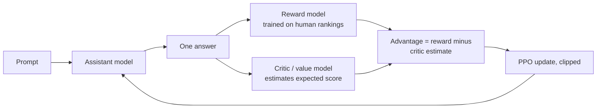
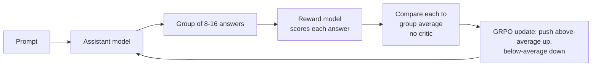
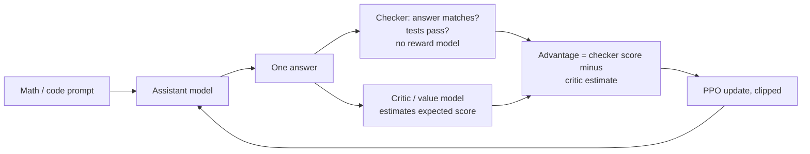
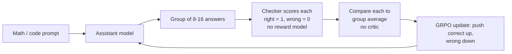

# How LLM Works — Next-Token Inference (simple reference)

Personal notes from Abhilash’s walkthrough (GPT-2-small–shaped numbers as examples). Pre-training taught the weights via next-token prediction; at inference those weights stay fixed.

## Steps for Pre-training

Self-supervised: labels come from the text itself (the actual next token). Weights are updated. No greedy / top-k / top-p picking.

1. **Take a text chunk** — e.g. `I love pizza` (the text is the label source).

2. **Tokenize** — Map the whole chunk to vocabulary IDs.

3. **Build input embeddings**
   - **Token embeddings** — Look up each ID → fixed-length vector (e.g. 768). The 768 is the length of each vector (a design size). The values inside are learned in pre-training; there is no separate training step before pre-training.
   - **Positional embeddings** — Add position vectors, then sum with token vectors.

4. **Transformer stack (one forward pass, causal mask)** — Feed the full sequence; each position only sees the past. In each layer:
   - **Attention** — Mix context from allowed past tokens.
   - **Feed-forward** — Transform that position’s vector with current weights.
   - Residuals / norms between.

5. **Vocab / LM head** — At every position, map hidden state → logits over the full vocabulary (guess for “token after me”).

6. **Softmax → probabilities** — Full distribution per position (usually temperature T = 1). Softmax *is* \(p_i = e^{z_i}/\sum_j e^{z_j}\).

7. **Loss vs true next token** — For each position, look at the model’s probability on the **actual** next token from the text (target = 1 on that ID, 0 elsewhere). Average cross-entropy. Do **not** greedy-pick first then compare.

8. **Backprop + optimizer** — Update embedding tables, transformer weights, and vocab head.

9. **Repeat / stop** — Next batch until stop rules (token or money budget, schedule done, held-out loss flattened; save checkpoints and roll back if held-out worsens).

**Note:** Feed-forward is a sublayer inside the stack, not the next-token trainer. Next-token prediction is the training objective (loss on step 7). Post-training comes after and refines behavior.

## Steps for Post-training

Post-training starts from the base model (pre-training only).

1. **Supervised fine-tuning (SFT). For thinking and non-thinking models.** Train on a user message plus one good reply, including tool-call examples.
2. **RLHF (preference tuning). For thinking and non-thinking models.** For answers you cannot automatically check (fuzzy quality like helpfulness, style, tone): people rank two replies, a reward model learns that ranking, and reinforcement learning (PPO or GRPO) nudges the assistant toward higher scores. This step stays shorter because the model can game the reward.
3. **RLVR (reinforcement learning with verifiable rewards). For thinking and non-thinking models.** For checkable answers (math, code tests): a checker scores each attempt right or wrong, and reinforcement learning (PPO or GRPO) pushes up the correct ones. Thinking models get long, heavy RLVR, which produces longer step-by-step reasoning that also carries over to fuzzy tasks; non-thinking models get only light RLVR to sharpen accuracy without long thinking.
4. **Optional extras.** Safety and more tool use are extra post-training passes, not part of pre-training.

After that, weights are frozen and inference is just using them.

## Steps for Inference

1. **Tokenize** — Split the prompt into tokens and map each to a vocabulary ID.

2. **Build input embeddings** — Turn each token into the vector the transformer will read.
   - **Token embeddings** — Look up each ID → a fixed-length vector (e.g. 768).
   - **Positional embeddings** — Add a position vector, then sum with the token vector.

3. **Transformer stack** — Run the sequence through N identical layers (e.g. 12). In each layer:
   - **Attention** — Mix context across positions into each token’s vector.
   - **Feed-forward** — Transform that vector with the layer’s fixed weights.
   - (Residuals / norms sit between these; same idea each layer.)

4. **Read the last position** — Keep only the final-layer vector on the last token; that is what predicts the next token.

5. **Vocab / LM head** — Multiply that vector by the vocabulary matrix → one logit per possible next token (e.g. ~50,257 for GPT-2 small).

6. **Softmax (logits → probabilities)** — Turn logits into a distribution that sums to 1.
   - **Temperature (optional)** — First divide logits by T (low T = peaked / less random; high T = flatter / more random), then apply softmax \(p_i = e^{z_i}/\sum_j e^{z_j}\). Softmax *is* this formula — its outputs *are* the probabilities.

7. **Choose next token** — Pick from that distribution using one strategy:
   - **Greedy** — Always take the highest probability (no randomness). Not a kind of sampling.
   - **Top-k sampling** — Keep the top k tokens by rank, renormalize, then randomly sample.
   - **Top-p sampling** — Keep the smallest set of top tokens whose cumulative probability ≥ p, renormalize, then randomly sample.

8. **Autoregressive loop** — Append the chosen token and repeat until EOS or max length.

- Only the **last** position is scored for the next token (1×768 → V logits), not every word in the sequence against the full vocab for this step.
- Softmax is not a step *after* “getting probabilities”; it is how logits become probabilities.

## Different Flavors of Reinforcement Learning

There are two key factors here:

1. **Reward source**
   - **Types of reward source:** a reward model (trained on human rankings, or an LLM judge) or a checker (the answer matches, or the tests pass).
   - **When to use which:** use a reward model for fuzzy responses like helpfulness, style or jokes (RLHF), and a checker for verifiable ones like math or code tests (RLVR).

2. **Reinforcement learning algorithm**
   - **Types of RL algorithm:** PPO (one answer per prompt, with a critic model as the baseline) or GRPO (a group of 8 to 16 answers, with the group average as the baseline and no critic).
   - **When to use which:** use PPO when you can afford the critic and want step-level credit, which is the classic RLHF choice. Use GRPO when you want a cheaper, simpler setup, especially with checker scores; it's the usual choice for reasoning models.

### 1. Reward model with PPO (classic RLHF)

### 2. Reward model with GRPO

### 3. Checker with PPO (RLVR, e.g. Tülu 3)

### 4. Checker with GRPO (RLVR, e.g. DeepSeek-R1)

